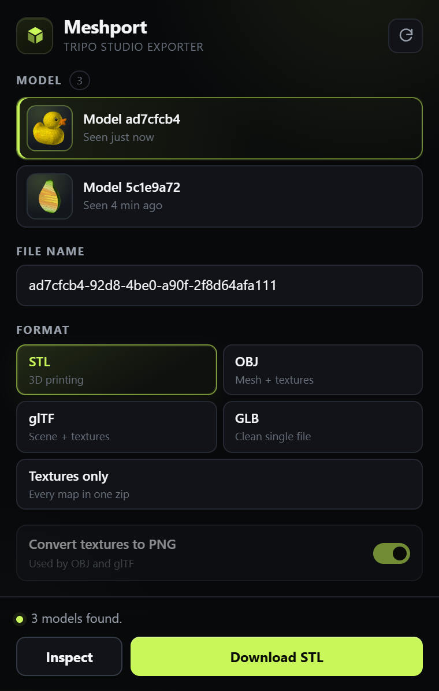

<p align="center">
  
</p>

<h1 align="center">Meshport</h1>

<p align="center">
  <a href="#license"></a>
  <a href="https://github.com/kaikochumi/meshport/actions/workflows/test.yml"></a>
  
</p>

Meshport is a browser extension that exports models from Tripo Studio and Meshy. It reads the library already loaded in your browser session: your whole Tripo library or the models in your Meshy workspace. Search the list, tick several models, and queue a batch as STL, OBJ, glTF, GLB, FBX, or a zip of textures. The conversion runs in your browser, it never calls a paid export API, and your models never leave it.

| | [Tripo Studio](https://studio.tripo3d.ai) | [Meshy](https://www.meshy.ai) |
| --- | --- | --- |
| What it exports | Your whole library, newest first | Your Meshy workspace library |
| Batch | Queue any models you select | Queue any models you select |
| Formats | STL, OBJ, glTF, GLB, FBX, textures | STL, OBJ, glTF, GLB, textures |
| Session | Your browser session | Your browser session |

Tripo serves models with `EXT_meshopt_compression` and `KHR_mesh_quantization`, which Blender, PrusaSlicer, and most other tools do not open. Meshport strips both extensions before it writes the output, so the files open in Blender, in slicers, and in game engines.

<p align="center">
  
</p>

## Features

The source switch at the top of the popup chooses between Tripo and Meshy. Each side keeps its own scan, selection, and colors, so switching never mixes one platform's models into the other.

### Search, selection, and the queue

- Search filters the list you already scanned by name, case and accent insensitive. It does not rescan or call a platform for the query.
- Sort by newest or by name. Selection sticks to the model, so filtering and sorting never change what will be exported.
- Tick the box on each card, or press `Select all` to take everything the search shows. Hidden models and Meshy cards without a download link are never exported, even when they are still selected.
- `Export N` sends the visible selection to the queue. The queue shows waiting, exporting, done, failed, and cancelled per item, exports one at a time, and keeps going after a failure.
- Cancel an item that has not started, retry a failure, and clear finished work when you are done. The queue is kept in `chrome.storage.session`: a popup reload keeps finished items, and an item that was mid-flight comes back as interrupted, never as done.

### On Tripo

- My Assets and Collected appear with their Tripo covers, newest first. Models without a cover get a preview rendered from the GLB, cached for the next open.
- The FBX card downloads Tripo's native file exactly as stored, with quad topology intact for Blender. It skips conversion and re-encoding entirely.
- Downloads resolve through the project detail and get verified against the ids Tripo embeds inside the file, so a preview of another asset never wins.
- Batch export resolves each model the same way, without navigating your Tripo tab. If Tripo does not expose a model as a GLB without opening it, that queue item fails with a message asking you to open the model once and rescan, and the rest of the batch continues.

### On Meshy

- Meshport reads your Meshy workspace library. The page usually fetched the list while you worked, and a script inside the tab hands it over, including answers the page received before the content script started. If an answer is missing, Meshport asks the same endpoints the workspace uses with your existing session; it needs no login, key, or export credit.
- The workspace's authenticated library answer carries each finished model's signed GLB link, so models the sidebar has listed can be exported without opening each one. A model that never appeared in a captured page answer has no link: its card says `Open once in Meshy`, its checkbox stays disabled, and `Select all` leaves it out. Open it once in Meshy, then rescan. If a link expires, Meshport re-reads the library for a fresh one before it gives up.
- The thumbnail comes from the render Meshy already made.
- If Meshy still refuses, reload the Meshy tab and rescan.
- Models that are still generating in Meshy appear after they finish, when there is a GLB to export.

Both platforms share `Inspect`, which decodes the model without saving it and shows the triangle count, the texture list, and texture sizes.

## Install

Meshport is not on the Chrome Web Store. Load it from the folder:

1. Download the [extension zip](https://github.com/kaikochumi/meshport/releases/latest) or clone this repository.
2. Open `chrome://extensions` in Chrome or `edge://extensions` in Edge.
3. Turn on `Developer mode`.
4. Click `Load unpacked` and select the `chrome-extension` folder.
5. Pin Meshport to the toolbar if the icon is hidden.

To update, replace the folder and click the reload button on the extensions page.

## Usage

### Tripo Studio

1. Open [Tripo Studio](https://studio.tripo3d.ai) and sign in.
2. Reload the Tripo tab after installing or updating Meshport, so the new content script is active.
3. Click the Meshport icon. The popup lists your library, newest first.
4. Pick a model, change the file name if you want, and choose a format. Double-clicking a model downloads it with the current format.
5. Click the download button.

### Meshy

1. Open your [Meshy workspace](https://www.meshy.ai/workspace) and sign in.
2. Reload the Meshy tab after installing or updating Meshport, so the new content script is active.
3. Click the Meshport icon and switch the source to Meshy. The popup scans by itself and lists the models in your library with their names and triangle counts.
4. Pick a format and download, or tick several models and press `Export N`.

Meshy exports as STL, OBJ, glTF, GLB, or a zip of textures. The thumbnail comes from the render Meshy already made. If a download link runs out, rescan the Meshy library; Meshport asks for a fresh link for that task when you retry.

### Batch export

1. With the Tripo or Meshy library loaded, search or sort to find the models you want.
2. Tick the checkbox on each card, or press `Select all` to take everything the search shows.
3. Pick the format. The whole batch uses it.
4. Press `Export N`. The queue opens and exports one model at a time.
5. In the queue, cancel an item that has not started, retry a failed one, or clear finished ones with `Clear finished`.

Keep the popup open while the queue runs. If it closes, the next open shows the interrupted item as failed so you can retry it. Batch export never opens or navigates your Tripo tab: a model that needs that step fails with a message asking you to open it once and rescan, while the rest of the batch keeps going. On Meshy, the workspace answer already carries signed links for the models its library listed, so those can go through the queue without opening each one. A model the page never loaded says `Open once in Meshy` on its card, stays out of `Select all`, and is skipped if it ever reaches the queue; open it once in Meshy and rescan. FBX stays Tripo-only.

### Both

Meshport remembers your selected model, format, and settings between uses. The Settings tab sets a subfolder inside Downloads, switches the download to ask for a folder each time, and picks the default format. `Inspect` decodes the model without saving it and shows the triangle count, the texture list, and texture sizes.

## Formats

| Format | What you get |
| --- | --- |
| STL | Binary STL, geometry only. Best for slicers. |
| OBJ | A zip with the `.obj`, `.mtl`, and a `textures` folder. |
| glTF | A zip with the `.gltf`, `.bin`, and a `textures` folder. |
| GLB | One decoded GLB, without meshopt or quantization. |
| FBX | Tripo's native file, exactly as stored. |
| Textures | A zip with every embedded texture. |

STL cannot store textures. Use OBJ or glTF when you need the maps.

FBX downloads the file Tripo keeps for the project. When Tripo stores a GLB or a zip instead, Meshport saves that with the matching extension; a single download says so in the status line.

On Meshy there is no FBX. The native FBX file only exists inside a Tripo project, so Meshport reads the GLB and converts from there.

## How the right model is picked

Tripo signs model links and they expire after a few minutes, so Meshport starts every download from the project detail endpoint. The page also loads previews of other assets, and those links can look identical to the model's own. Two checks keep them apart:

- A capture only counts when its file stem matches an id the project detail reports.
- Every GLB is probed for the `tripo_node_<id>` names Tripo embeds inside the file, the same ids Blender shows after an import.

## Privacy

- Everything runs in the extension. Models and textures never leave the browser.
- Meshport uses the Tripo and Meshy sessions already active in your browser and contacts only their hosts to read your library and download the files. It does not read your password or store a token.
- Download only models you have the right to use.

## Troubleshooting

**The wrong model downloads.** Reload Meshport on the extensions page, then reload the Tripo tab, and try again. If it still happens, right-click the Meshport icon, choose `Inspect popup`, open the Console tab, and look for the `[Meshport]` lines. They show exactly which link was chosen and why. `JSON.parse(localStorage["meshport/last-download"])` in that console replays the whole decision.

**A download says the link expired.** The signed link ran out. Meshport refreshes it once automatically; open the model in Tripo and rescan if it keeps failing.

**The library is empty.** Reload the Tripo tab so the content script can read the session, then rescan.

**Meshy has nothing to export.** The popup reads your Meshy workspace library. Make sure the workspace is open and signed in, then rescan. If it still fails, reload the Meshy tab so the content script is active. Models that are still generating appear after they finish.

**A queued model says to open it in Tripo once.** Tripo did not expose that model as a GLB through project detail, and the queue will not walk your tab through the library for you. Open the model in Tripo, rescan the library, then retry the item.

**The queue stopped when the popup closed.** Anything that was mid-flight comes back as failed with an interrupted message. Press `Retry`; finished items are still there. Keep the popup open until the queue is done.

**A Meshy item failed after a while.** The signed link expired while the item waited. Rescan the Meshy library, then retry the item; Meshport asks for a fresh link for that task.

## Development

```bash
npm install
npm test
```

The suite covers the GLB parser, texture extraction, OBJ and MTL output, the zip writer, the glTF package builder, the meshopt decode path, library card parsing, model file detection, the export queue state machine, and library search and sorting. It runs against `test/fixtures/cube-meshopt.glb`, a cube compressed with `gltfpack -cc`.

`npm run test:e2e` drives a real browser through both platforms: the Tripo library, the Meshy library scan against a direct list with no signed links, the round trip, a Meshy batch of models that were never opened, a linkless Meshy model kept out of the selection, and a queued Tripo batch with search, multi-select, sorting, queue persistence, and interrupted-item restore. It looks for Edge in the standard install location; set `MESHPORT_EDGE_PATH` when it lives elsewhere.

Rebuild the decoder bundle after upgrading glTF Transform or meshoptimizer:

```bash
npm run build:vendor
```

Regenerate the fixture:

```bash
npm run make:fixture
```

`chrome-extension/vendor/tripo_loader.js` is generated from `tools/vendor-entry.js` and bundles `@gltf-transform/core`, `@gltf-transform/extensions`, and the meshoptimizer decoder. Licenses are in `THIRD_PARTY_NOTICES.md`.

## License

Meshport itself is MIT-licensed, see [LICENSE](LICENSE). The bundled decoders keep their own licenses, listed in [THIRD_PARTY_NOTICES.md](THIRD_PARTY_NOTICES.md).

---

<p align="center">
  <sub><a href="https://github.com/ChesterTheCatt/meshy-ai-to-stl">Meshy AI to STL</a> by <a href="https://github.com/ChesterTheCatt">ChesterTheCatt</a> was the starting point for the exporters.</sub>
</p>
