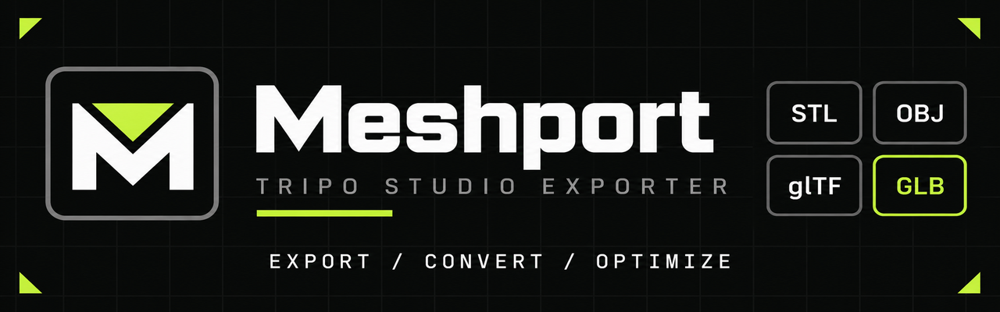

<p align="center">
  
</p>

<h1 align="center">Meshport</h1>

<p align="center">
  <a href="#license"></a>
  <a href="https://github.com/kaikochumi/meshport/actions/workflows/test.yml"></a>
  
</p>

Meshport is a browser extension that exports models from your Tripo Studio library. It reads the library with the session already open in Tripo, fetches each model, decodes it in the browser, and saves it as STL, OBJ, glTF, GLB, FBX, or a zip of textures. It does not call the Tripo export API or spend export credits, and your models never leave the browser.

Tripo serves models with `EXT_meshopt_compression` and `KHR_mesh_quantization`, which Blender, PrusaSlicer, and most other tools do not open. Meshport strips both extensions before it writes the output, so the files open in Blender, in slicers, and in game engines.

<p align="center">
  
</p>

## Features

- My Assets and Collected appear with their Tripo covers, newest first. Models without a cover get a preview rendered from the GLB, cached for the next open.
- The FBX card downloads Tripo's native file exactly as stored, with quad topology intact for Blender. It skips conversion and re-encoding entirely.
- Downloads resolve through the project detail and get verified against the ids Tripo embeds inside the file, so a preview of another asset never wins.
- Inspect shows the triangle count, the texture list, and texture sizes without saving anything.

## Install

Meshport is not on the Chrome Web Store. Load it from the folder:

1. Download or clone this repository.
2. Open `chrome://extensions` in Chrome or `edge://extensions` in Edge.
3. Turn on `Developer mode`.
4. Click `Load unpacked` and select the `chrome-extension` folder.
5. Pin Meshport to the toolbar if the icon is hidden.

To update, replace the folder and click the reload button on the extensions page.

## Usage

1. Open [Tripo Studio](https://studio.tripo3d.ai) and sign in.
2. Reload the Tripo tab after installing or updating Meshport, so the new content script is active.
3. Click the Meshport icon. The popup lists your library, newest first.
4. Pick a model, change the file name if you want, and choose a format. Double-clicking a model downloads it with the current format.
5. Click the download button.

Meshport remembers your selected model, format, and settings between uses.

The Settings tab sets a subfolder inside Downloads, switches the download to ask for a folder each time, and picks the default format.

`Inspect` decodes the model without saving it and shows the textures, their sizes, and the triangle count.

## Formats

| Format | What you get |
| --- | --- |
| STL | Binary STL, geometry only. Best for slicers. |
| OBJ | A zip with the `.obj`, `.mtl`, and a `textures` folder. |
| glTF | A zip with the `.gltf`, `.bin`, and a `textures` folder. |
| GLB | One decoded GLB, without meshopt or quantization. |
| FBX | Tripo's native file, exactly as stored. |
| Textures | A zip with every embedded texture. |

STL cannot store textures. Use OBJ or glTF when you need the maps.

FBX downloads the file Tripo keeps for the project. When Tripo stores a GLB or a zip instead, Meshport saves that and says so in the status line.

## How the right model is picked

Tripo signs model links and they expire after a few minutes, so Meshport starts every download from the project detail endpoint. The page also loads previews of other assets, and those links can look identical to the model's own. Two checks keep them apart:

- A capture only counts when its file stem matches an id the project detail reports.
- Every GLB is probed for the `tripo_node_<id>` names Tripo embeds inside the file, the same ids Blender shows after an import.

## Privacy

- Everything runs in the extension. Models and textures never leave the browser.
- Meshport uses the Tripo session already active in your browser. It does not read your password or store a token.
- Download only models you have the right to use.

## Troubleshooting

**The wrong model downloads.** Reload Meshport on the extensions page, then reload the Tripo tab, and try again. If it still happens, right-click the Meshport icon, choose `Inspect popup`, open the Console tab, and look for the `[Meshport]` lines. They show exactly which link was chosen and why. `JSON.parse(localStorage["meshport/last-download"])` in that console replays the whole decision.

**A download says the link expired.** The signed link ran out. Meshport refreshes it once automatically; open the model in Tripo and rescan if it keeps failing.

**The library is empty.** Reload the Tripo tab so the content script can read the session, then rescan.

## Development

```bash
npm install
npm test
```

The suite covers the GLB parser, texture extraction, OBJ and MTL output, the zip writer, the glTF package builder, the meshopt decode path, library card parsing, and model file detection. It runs against `test/fixtures/cube-meshopt.glb`, a cube compressed with `gltfpack -cc`.

Rebuild the decoder bundle after upgrading glTF Transform or meshoptimizer:

```bash
npm run build:vendor
```

Regenerate the fixture:

```bash
npm run make:fixture
```

`chrome-extension/vendor/tripo_loader.js` is generated from `tools/vendor-entry.js` and bundles `@gltf-transform/core`, `@gltf-transform/extensions`, and the meshoptimizer decoder. Licenses are in `THIRD_PARTY_NOTICES.md`.

## License

MIT. See [LICENSE](LICENSE) and [THIRD_PARTY_NOTICES.md](THIRD_PARTY_NOTICES.md).

<p align="center">
  <sub><a href="https://github.com/ChesterTheCatt/meshy-ai-to-stl">Meshy AI to STL</a> by <a href="https://github.com/ChesterTheCatt">ChesterTheCatt</a> was the starting point for the exporters.</sub>
</p>
